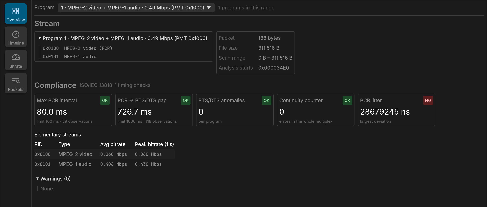
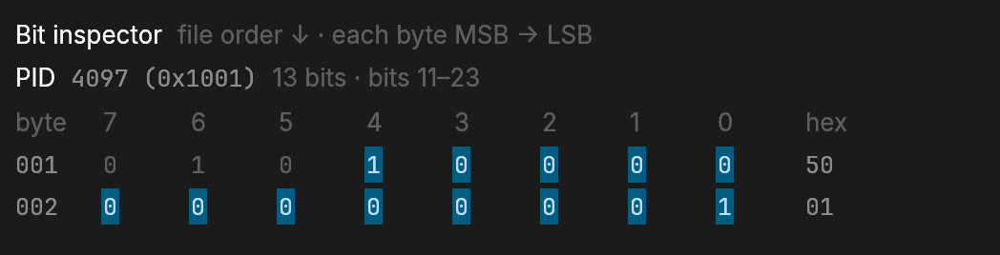

# mpeg-ts-analyzer

[](https://github.com/small-teton/mpeg-ts-analyzer/actions/workflows/go.yml)

[](https://pkg.go.dev/github.com/small-teton/mpeg-ts-analyzer/v2)
[](https://github.com/small-teton/mpeg-ts-analyzer/releases)

[](https://github.com/avelino/awesome-go)

mpeg-ts-analyzer is an MPEG-2 Transport Stream analyzer (ISO/IEC 13818-1).


# Desktop GUI

A desktop GUI is under active development in [`gui/`](gui/). It runs the CLI
as a subprocess and connects the Overview, Timeline, Bitrate, and Packets views
to the same analysis results.

GUI packages for macOS (Apple silicon), Linux (`.deb`, AppImage) and Windows
(installer, portable zip) are published on the
[releases page](https://github.com/small-teton/mpeg-ts-analyzer/releases) under
`gui-v<version>` tags, separately from the CLI releases. Each package bundles
the CLI of the same commit. The packages are not code-signed; the release notes
explain how to open them and how to verify a download.

<p align="center">
  <a href="docs/images/gui-overview.png">
    
  </a>
  <a href="docs/images/gui-bit-inspector.png">
    
  </a>
</p>

The Overview brings the detected program layout, stream properties, timing
compliance verdicts, continuity errors, PCR jitter, and per-stream bitrate into
one screen.

## Inspect packets down to individual bits

Select any decoded TS, adaptation-field, PSI, or PES field to highlight both
its source bytes and its exact bit range. Multi-byte, non-byte-aligned fields
are shown across byte boundaries; the 13-bit PID in the packet view spans the
low five bits of one byte and all eight bits of the next byte.

The Bit inspector follows packet/file order from top to bottom and displays
each byte from MSB (`bit 7`) to LSB (`bit 0`), making it straightforward to
compare raw packet data with ISO/IEC 13818-1 field layouts.

# Command-line analyzer

It parses TS packets and checks whether the stream conforms to the following requirements defined in the specification:

- **Max PCR interval** should be no greater than 100 ms (ISO/IEC 13818-1, Section 2.7.2); intervals are not measured across a PCR that carries `discontinuity_indicator`, and a PCR wraparound is measured as a normal interval (see [OPTIONS.md](OPTIONS.md#timing-compliance-verdicts-and---fail-on-error))
- **PCR-PTS/DTS max gap** (decode delay) should be no greater than 1000 ms; DTS is used when both timestamps are present, otherwise PTS is used
- **PTS/DTS anomalies** — timestamps going backward, 33-bit wraparound, large forward jumps (splicing/ad insertion), or DTS later than PTS — are detected and reported (always on; silent when the stream is healthy)

In addition, it can dump various MPEG-2 TS internal structures for stream investigation:

- TS header and payload
- Adaptation field (including PCR)
- PSI tables (PAT/PMT) with CRC32 validation, assembled across every section of the table
- PAT/PMT version changes during the analysis (moved PMT or PCR PID, added, removed or retyped elementary streams), followed and reported with their byte offsets
- PSI layout of an analyzed range (`--output analysis`): the PAT/PMT sections seen, the layout in effect over each byte interval, and every PID observed with what it carries
- PMT ES info descriptors (ISO 639 language, registration, AVC/HEVC video, AAC audio, teletext, DVB subtitling)
- PES header with PTS/DTS timestamps
- PCR jitter analysis (per-interval deviation from the expected PCR)
- `continuity_counter` validation with an always-on per-PID error summary

Both 188-byte TS packets and 192-byte M2TS packets (BDAV format with TP_extra_header) are supported. The packet size is auto-detected from the stream.

Continuity counters are checked at the TS layer for every non-null PID observed
during the selected program's analysis, including PSI/SI, unreferenced PIDs,
and PIDs belonging to other programs. Checking is stream-wide within this
window; `--program` does not filter continuity checks to that program's PIDs.
Counters advance only on payload packets, wrap from 15 to 0, accept
duplicates (allowing only PCR values to differ), and start a new segment at `discontinuity_indicator`. PUSI packets
are checked normally, adaptation-only packets do not advance the counter, and
the tracker resynchronizes after each reported event. Null PID `0x1FFF` is
excluded. The summary counts discontinuity events, not estimated missing
packets; see [OPTIONS.md](OPTIONS.md#continuity-counter-summary-always-on).

**Note:** The accuracy of the output is not guaranteed.

# Install

## Homebrew (macOS / Linux)

```bash
brew install small-teton/tap/mpeg-ts-analyzer
```

## Linux packages (deb / rpm / apk)

Download `.deb`, `.rpm`, or `.apk` packages from the [Releases](https://github.com/small-teton/mpeg-ts-analyzer/releases) page.

```bash
# Debian / Ubuntu
curl -LO https://github.com/small-teton/mpeg-ts-analyzer/releases/latest/download/mpeg-ts-analyzer_<version>_linux_amd64.deb
sudo dpkg -i mpeg-ts-analyzer_<version>_linux_amd64.deb

# RHEL / CentOS / Fedora
curl -LO https://github.com/small-teton/mpeg-ts-analyzer/releases/latest/download/mpeg-ts-analyzer_<version>_linux_amd64.rpm
sudo rpm -i mpeg-ts-analyzer_<version>_linux_amd64.rpm

# Alpine
curl -LO https://github.com/small-teton/mpeg-ts-analyzer/releases/latest/download/mpeg-ts-analyzer_<version>_linux_amd64.apk
sudo apk add --allow-untrusted mpeg-ts-analyzer_<version>_linux_amd64.apk
```

## Pre-built binaries

Download from the [Releases](https://github.com/small-teton/mpeg-ts-analyzer/releases) page. No additional tools are required.

## Install with Go

If you have a [Go](https://go.dev/dl/) environment (1.26+):

```bash
go install github.com/small-teton/mpeg-ts-analyzer/v2@latest
```

# Usage

By default, mpeg-ts-analyzer prints deterministic `OK`, `NG`, or `SKIPPED`
verdicts for the maximum PCR interval and PCR-to-PTS/DTS gap. Individual PCR,
PTS, and DTS lines remain opt-in through `--dump-timestamp`.

```
Usage:
  mpeg-ts-analyzer [input file path] [flags]

Flags:
      --capabilities            Print the supported machine-readable outputs as JSON and exit (no input file).
      --count int               With --output packets: maximum number of packets in the page. (default 100)
      --dump-adaptation-field   Dump TS packet adaptation_field detail.
      --dump-bitrate            Summarize per-PID average/peak bitrate (PCR time base) for the analyzed program.
      --dump-pcr-jitter         Analyze PCR jitter (per-interval deviation from the expected PCR).
      --dump-pes-header         Dump PES packet header detail.
      --dump-psi                Dump PSI(PAT/PMT) detail.
      --dump-timestamp          Dump PCR/PTS/DTS timestamps.
      --dump-ts-header          Dump TS packet header.
      --dump-ts-payload         Dump TS packet payload binary.
      --fail-on-error           Exit with code 2 when a timing compliance check reports NG.
      --format string           Output format: text or json. (default "text")
  -h, --help                    help for mpeg-ts-analyzer
      --limit int               Stop reading after this many bytes (0 = no limit).
      --list-programs           List every program (program_number, PMT PID, service name, elementary streams) and exit.
      --offset int              Start reading from this byte offset.
      --output string           JSON output: summary, analysis (every program with time series), packets (a page of packets) or packet (one packet decoded); needs --format json. (default "summary")
      --packet-size int         With --output packets or packet: packet size 188 or 192 (0 = detect).
      --program int             Analyze only this program_number (default: the sole program; a multi-program stream is listed instead).
      --progress string         Write progress events to stderr in this format: json.
      --range-limit int         With --output packet: length of that scan range in bytes (0 = to the end of the file).
      --range-offset int        With --output packet: start of the scan range searched for the packet's PES or section.
      --version                 show mpeg-ts-analyzer version.
```

## JSON output for automation

Use `--format json` when the result will be consumed by CI, monitoring, or
another program:

```sh
mpeg-ts-analyzer input.ts --format json
mpeg-ts-analyzer input.ts --format json --dump-pcr-jitter --dump-bitrate
```

JSON mode writes exactly one JSON document to stdout. Errors and Cobra usage
diagnostics go to stderr, so redirecting or piping stdout remains safe. A failed
analysis still emits a valid document with `status: "failed"` and a
stable `reason` code plus a human-readable `error`, then exits with the usual
non-zero status. Multi-program
listing and insufficient-data checks are represented separately by
`status: "programs_listed"` and per-check `skipped` states. An `incomplete`
result exits 0 for compatibility with text mode; automation should require
`status == "complete"` rather than relying on the exit code alone.

For plotting, `--output analysis` analyzes every program of the range in one
pass and adds per-program time series (PCR intervals, PTS/DTS and PCR gaps,
jitter, 1-second bitrate windows) under its own schema, plus the PSI layout of
the range (`psi_layout`: PAT/PMT sections, the layouts in effect and their byte
intervals, and every observed PID with what it carries); see
[OPTIONS.md](OPTIONS.md#range-analysis-output---output-analysis) and
[OPTIONS.md](OPTIONS.md#psi-layout-of-the-range). `--output
packets` pages through packets (with the headers of the PSI sections that
start in each packet) and `--output packet` decodes one packet with
the byte position of every field, plus the exact bits of fields that do not
fill whole bytes ([OPTIONS.md](OPTIONS.md#packet-pages---output-packets)).

The document contains summaries, not one object per transport packet. Its size
therefore does not grow with the input file's packet count (apart from naturally
variable summary collections such as encountered PIDs, warnings, and detected
anomalies). Analysis remains streaming, making JSON suitable for large files.

Long-running callers can add `--progress json` to receive progress events on
stderr, and `mpeg-ts-analyzer --capabilities` reports which machine-readable
outputs and schema versions a build supports. See
[OPTIONS.md](OPTIONS.md#progress-events).
Packet-level flags (`--dump-ts-header`, `--dump-ts-payload`,
`--dump-adaptation-field`, `--dump-psi`, `--dump-pes-header`, and
`--dump-timestamp`) are intentionally incompatible with JSON mode; their large,
human-oriented output remains available in the default text mode.

PID values are zero-padded hexadecimal strings such as `"0x0100"`. Numeric
units are part of field names, for example `value_ms`, `offset_bytes`, and
`average_bps`. The top-level `schema_version` is currently `"1.0"`. Within one
schema version, new fields may be added, but existing fields will not be removed
or change type or enum meaning. New enum values may be added, so consumers must
treat unknown values as unrecognized. Removing or retyping a field, or changing
an existing enum's meaning, requires a schema-version increment.
See [OPTIONS.md](OPTIONS.md#json-output) for an annotated example.
The machine-readable contract is published as
[`docs/json-schema-v1.json`](docs/json-schema-v1.json) (JSON Schema Draft
2020-12).

The timing checks use inclusive limits: exactly 100 ms for the maximum PCR
interval and exactly 1000 ms for the PCR-to-PTS/DTS gap are `OK`. A check is
`SKIPPED` when there are not enough comparable observations; `SKIPPED` does not
make `--fail-on-error` fail. Exit codes are:

- `0`: parsing completed and no evaluated timing check reported `NG`
- `1`: usage, input, or parsing error
- `2`: parsing completed but `--fail-on-error` found one or more `NG` checks

Example default result:

```text
-----------------------------
Compliance Check Results:
Max PCR interval: 80.000000ms [OK, limit: <= 100.000000ms]
PCR-PTS/DTS max gap: 726.666667ms [OK, limit: <= 1000.000000ms]
```

## Multi-program transport streams

A single-program stream (a recording or an extracted service) is analyzed
directly. A **multi-program** stream — e.g. a raw broadcast capture (ISDB-T
carries a main service plus 1seg; BS/CS muxes carry many channels) — is not
analyzed program-by-program by default: the tool lists the programs and stops,
so you can pick one.

```
$ ./mpeg-ts-analyzer capture.ts
Detected PAT: 2 program(s)
Multiple programs detected; pass --program <program_number> to analyze one:
Program 1: PMT PID 0x1000, PCR PID 0x0100
PMT : Program Info : elementary_PID     : 0x100, stream_type : 0x1b (AVC video ...)
PMT : Program Info : elementary_PID     : 0x110, stream_type : 0x0f (AAC audio ...)
Program 2: PMT PID 0x1001, PCR PID 0x0110
PMT : Program Info : elementary_PID     : 0x120, stream_type : 0x02 (1seg video ...)

$ ./mpeg-ts-analyzer capture.ts --program 1     # analyze one program fully
$ ./mpeg-ts-analyzer capture.ts --list-programs # list only the programs, even when there is just one
```

Listing only parses each program's PMT (no PES analysis), so it stays lightweight.
When the stream names its services in a DVB SDT (as FFmpeg does), the listing
adds a `Service:` line with the service and provider name, and JSON output adds
`service` to each program; see [OPTIONS.md](OPTIONS.md#service-names-sdt).

PAT and PMT tables split into several sections are collected completely before
programs are listed or selected, and programs are listed in `program_number`
order. Missing sections, inconsistent section sets, and invalid CRCs are
reported as warnings instead of producing a partial table; see
[OPTIONS.md](OPTIONS.md#multi-section-pat-and-pmt).

Long captures can update the PAT or PMT while they are analyzed. The analyzer
keeps collecting both tables and applies a new version once all its sections
have arrived: a moved PMT is read from its new PID, a new `PCR_PID` starts a new
PCR timing segment (no interval, jitter or bitrate window spans the change),
and elementary streams that are added, removed or change `stream_type` start
or stop cleanly. Each applied change is printed with its offset in text mode
and listed under `psi_transitions` in JSON; a program removed from the PAT
stops being analyzed there. `--output analysis` also reports each layout with
the byte interval it applies to (`psi_layout`). See
[OPTIONS.md](OPTIONS.md#pat-and-pmt-version-changes).

**Tip:** For large files, dump options can produce a huge amount of output. Use `--limit` to restrict the byte range, or redirect output to a file to avoid losing the beginning of the output in your terminal scrollback:

```bash
mpeg-ts-analyzer large.ts --dump-ts-header --limit 1000000 > dump.txt
```

# Options & output examples

Every flag has a full, annotated output example — TS header, PSI, timestamps,
PCR jitter, and per-PID bitrate — in **[OPTIONS.md](OPTIONS.md)**.

# Why mpeg-ts-analyzer?

mpeg-ts-analyzer is purpose-built for one job: **checking transport-layer timing compliance** — the Max PCR interval and the PCR-PTS/DTS (decode-timeline) gap — and reporting a direct pass/fail answer.

## Compared to other tools

- **ffprobe / FFmpeg** work at the elementary-stream (codec) level. They expose PTS/DTS but **not the PCR**, which lives in the transport layer (adaptation field). PCR interval and PCR-PTS/DTS gap checks are therefore out of reach — ffprobe simply never surfaces the PCR.
- **TSDuck** is an excellent, comprehensive TS toolkit and it *can* obtain these values (e.g. `tsp -P pcrextract` dumps PCR/PTS/DTS to CSV). However, it hands you the raw timestamps — you still have to script the interval/gap computation and make the pass/fail decision yourself. TSDuck gives you the parts; it does not directly give you the answer.

mpeg-ts-analyzer instead gives you:

- **Spec-level field dump** — Every field in TS headers, adaptation fields, PSI tables, and PES headers is printed exactly as defined in ISO/IEC 13818-1, making it easy to cross-reference with the specification.
- **Compliance checks out of the box** — Max PCR interval (≤ 100 ms) and PCR-PTS/DTS gap (≤ 1000 ms) are validated automatically and reported as a direct result. No CSV, no scripting.

## Which tool should I use?

- **Transport-layer timing compliance** (Max PCR interval / PCR-PTS/DTS gap), or a lightweight pass/fail check you can drop into CI → **mpeg-ts-analyzer**. This is what it is built for.
- **Broad, general analysis of a stream** — full PSI/SI tables (NIT/SDT/EIT/…), bitrate breakdown, service names, scrambling state, network information, deep TR 101 290 conformance monitoring → **[TSDuck](https://tsduck.io/)** is the far more capable tool, and we recommend it for that use case.

mpeg-ts-analyzer deliberately stays small and focused on the compliance check rather than duplicating what TSDuck already does well.

Sample TS files are included in `sample_data/` for quick testing:

```bash
# 188-byte TS
ffmpeg -f lavfi -i "color=c=blue:s=320x240:d=5,format=yuv420p" \
       -f lavfi -i "anullsrc=r=48000:cl=stereo" \
       -t 5 -c:v mpeg2video -c:a mp2 -metadata:s:a:0 language=eng \
       -f mpegts sample_data/sample_188byte_video_mpeg2_320x240_25fps_audio_mp2_48000Hz.ts

# 192-byte M2TS
ffmpeg -f lavfi -i "color=c=red:s=320x240:d=2,format=yuv420p" \
       -f lavfi -i "anullsrc=r=48000:cl=stereo" \
       -t 2 -c:v mpeg2video -c:a mp2 -metadata:s:a:0 language=eng \
       -f mpegts -mpegts_m2ts_mode 1 sample_data/sample_192byte_video_mpeg2_320x240_25fps_audio_mp2_48000Hz.ts
```

# Development

See [docs/DEVELOPMENT.md](docs/DEVELOPMENT.md) for development environment
setup, testing, coverage, and documentation workflows.

# Release

Releases are cut from the `VERSION` file. The tag is always `v<VERSION>`, so
`VERSION` must contain a bare semver (`X.Y.Z`) with no leading `v` and no extra
dots — a malformed value like `.1.5.0` produces the invalid tag `v.1.5.0` and
fails the release.

1. **Bump the version in a PR.** Edit `VERSION` (e.g. `1.4.0` → `1.5.0`) and merge
   the PR to `master`. Do not tag by hand.
2. **Run the Release workflow.** In GitHub → Actions → **Release** → *Run workflow*
   on `master` (`workflow_dispatch`, so only users with write access can start
   it). The workflow refuses other branches. In one job it:
   1. checks `VERSION`, that the commit is on `master`, and the state of the
      `v<VERSION>` tag and release;
   2. builds every archive and package with GoReleaser without publishing, and
      checks that the built CLI reports `VERSION`;
   3. creates the tag only then;
   4. builds again with GoReleaser and uploads a **draft** release (archives,
      Linux packages, checksums and the Homebrew cask);
   5. publishes the draft only if its checksums equal those of the checked
      build, with build provenance for each archive and package.

That is the whole flow — bump `VERSION` in a PR, then trigger the workflow.

The two builds are identical because `.goreleaser.yaml` pins every timestamp
and file owner. They run in the same job because the rpm records the build
host. GoReleaser builds twice since its open-source edition cannot publish an
earlier build.

A tag `vX.Y.Z` pushed by a user (`make release`) starts the same workflow. The
tag must match `VERSION` and point at a commit on `master`. Prefer the
workflow, so the tag is created only after the build has passed.

A failed run can be started again:

- If the tag does not exist yet, nothing was published.
- If the tag points at the checked commit but the release is still a draft or
  missing, the rerun builds again and replaces the draft.
- If the release is already published, the run stops without changing it.
- If the tag points at another commit, the run fails. The workflow never moves
  or deletes a tag.
