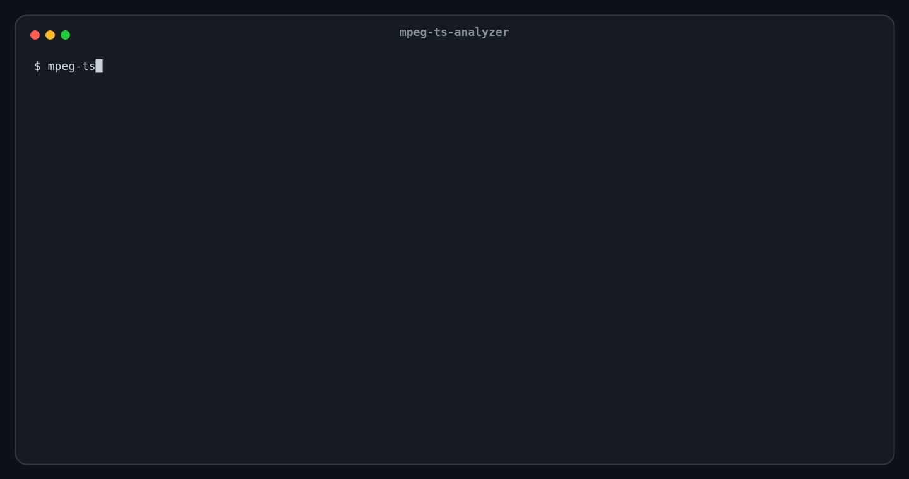

# mpeg-ts-analyzer

[](https://github.com/small-teton/mpeg-ts-analyzer/actions/workflows/go.yml)

[](https://pkg.go.dev/github.com/small-teton/mpeg-ts-analyzer/v2)
[](https://github.com/small-teton/mpeg-ts-analyzer/releases)

[](https://github.com/avelino/awesome-go)

mpeg-ts-analyzer is an MPEG-2 Transport Stream analyzer (ISO/IEC 13818-1) for
188-byte TS and 192-byte M2TS files. It checks transport-layer timing and gives
a direct pass/fail answer, and it decodes every packet down to its fields and
bits.



## What it checks

- **Max PCR interval**: no greater than 100 ms (ISO/IEC 13818-1, 2.7.2).
- **PCR discontinuities**: a PCR that jumps backward, or more than 1000 ms
  forward, without `discontinuity_indicator` (ISO/IEC 13818-1, 2.4.3.5);
  declared discontinuities, `PCR_PID` changes and wraparounds are listed.
- **PCR → PTS/DTS gap** (decode delay): no greater than 1000 ms.
- **PTS/DTS anomalies**: timestamps going backward, wraparound, large forward
  jumps, or DTS later than PTS.
- **Continuity counters** of every PID, and the **PAT/PMT layout** of the range,
  including tables split into sections and version changes.
- **TS synchronization**: packets without their sync byte, with byte offsets,
  and bounded realignment so that later results are still reported.
- **Transport errors and scrambled packets** per PID: affected packets are
  counted; the PSI/PES payload of both is kept out of the analysis, and so is
  the PCR of a packet marked with `transport_error_indicator`, while a
  scrambled packet's PCR (in its clear adaptation field) is still used. Only
  the 4-byte header of a marked packet is read, so one with a malformed
  adaptation field is counted instead of stopping the analysis.
- **PAT/PMT health**: whether the PAT and the PMT of every announced program
  were found, repeat at least every 500 ms (the ETSI TR 101 290 1.3.a/1.5.a
  value, timed by PCR), and arrive with valid CRC, syntax and table_id.
- **PID references**: PMT, PCR and elementary-stream PIDs that the PAT/PMT
  reference but that are absent or silent for more than 5 s, and PIDs that
  carry packets without being referenced (after a 0.5 s grace period).
- **PES headers** of every elementary stream (truncated, bad start code,
  flags, lengths or PTS/DTS marker bits), and **PTS repetition**: a PTS at
  least every 700 ms on video and audio streams (ISO/IEC 13818-1, 2.7.4).
- **Packet gaps** (report only): for every PID, the longest run of other
  packets between two of its packets, in packets and estimated milliseconds,
  to spot poorly interleaved (bursty) multiplexes. No verdict is attached.

Results are text for people, or JSON with a published schema for CI and other
programs. See [CLI usage][docs-cli-usage].

## Desktop GUI

The desktop GUI runs the CLI and shows one analysis in four linked views:
Overview, Timeline, Bitrate and Packets.

<p align="center">
  <a href="docs/images/gui-tabs.png">
    
  </a>
</p>

Select any decoded field of a packet to see its bytes and its exact bits, even
when a field such as the 13-bit PID spans two bytes:

<p align="center">
  <a href="docs/images/gui-inspectors.png">
    
  </a>
</p>

See the [GUI guide][docs-gui].

## Install

```bash
brew install small-teton/tap/mpeg-ts-analyzer        # CLI, macOS / Linux
go install github.com/small-teton/mpeg-ts-analyzer/v2@latest
```

Linux packages, pre-built binaries and the GUI packages for macOS, Linux and
Windows are on the [releases page](https://github.com/small-teton/mpeg-ts-analyzer/releases);
see [Installation][docs-installation].

## Quick start

```bash
mpeg-ts-analyzer input.ts                  # timing compliance verdicts
mpeg-ts-analyzer input.ts --format json    # the same, as one JSON document
```

```text
Compliance Check Results:
Max PCR interval: 80.000000ms [OK, limit: <= 100.000000ms]
PCR discontinuities: 0 undeclared in 60 PCRs [OK]
PCR-PTS/DTS max gap: 726.666667ms [OK, limit: <= 1000.000000ms]
```

In the GUI, open a file (or drop it on the window), choose the scan range and
press **Start**. More in the [Quick start][docs-quickstart].

## Documentation

The [documentation site][docs-site] has every guide, with navigation and
search. Its pages are the Markdown under [`docs/`](docs/), which also reads on
GitHub.

- [Installation][docs-installation] and [Quick start][docs-quickstart]
- [CLI usage][docs-cli-usage], [PSI tables][docs-psi] and
  [dump output examples][docs-dumps]
- [Desktop GUI][docs-gui]
- [Machine-readable output][docs-json-output] and the [JSON schema][docs-json-schema]
- [Development][docs-development], [release][docs-release] and
  [security policy](SECURITY.md)

## Why mpeg-ts-analyzer?

mpeg-ts-analyzer combines transport-stream checks with detailed inspection. It
reports timing, continuity and PSI/PES findings, plots timing and bitrate, and
lets you follow a finding down to the exact packet, field, byte and bit.

Its main strength is not continuous monitoring or exhaustive validation of an
entire long-running service. Instead, you can select a bounded range around the
behavior you want to understand and examine it from a high-level verdict down
to its binary representation. This makes the tool particularly useful for
validating muxer output, investigating a suspicious section of a stream, and
learning how MPEG-2 TS structures are encoded.

### Compared to other tools

- **ffprobe / FFmpeg** are a natural choice for codecs, elementary streams and
  playback-oriented metadata. They do not provide the same packet-field-to-bit
  inspection workflow for the MPEG-2 TS transport layer.
- **TSDuck** is an excellent, comprehensive TS toolkit for broad stream
  analysis, processing, monitoring and deep conformance work. Use it when you
  need that breadth, especially across a complete or live service.

mpeg-ts-analyzer instead gives you:

- **A focused range** — Use a byte offset and limit to isolate the section
  you want to verify instead of starting with the entire stream.
- **Checks and context together** — See transport findings alongside timing,
  bitrate, PSI/PES and packet data rather than receiving only a verdict.
- **Spec-level inspection** — Decode TS headers, adaptation fields, PSI tables
  and PES headers, then map a selected field to its exact bytes and bits.

### Which tool should I use?

- To verify or learn from a specific range, correlate transport checks with the
  timeline, or inspect a field down to its bits → **mpeg-ts-analyzer**.
- For continuous or whole-service monitoring, stream processing, complete
  PSI/SI coverage, or deep TR 101 290 conformance work →
  **[TSDuck](https://tsduck.io/)**.
- For codec and elementary-stream inspection → **ffprobe / FFmpeg**.

### Background

mpeg-ts-analyzer started in 2016 as a small tool for checking timestamp gaps,
written partly to learn Go. To learn MPEG-2 TS itself, it also printed every
header field in detail — the origin of today's spec-level dumps. It has since
grown to include transport checks, machine-readable output and a desktop GUI,
while keeping that original emphasis on understanding a selected part of a
stream in detail.

**Note:** The accuracy of the output is not guaranteed.

## License

Apache License 2.0; see [LICENSE](LICENSE).

[docs-cli-usage]: https://small-teton.github.io/mpeg-ts-analyzer/cli/usage/
[docs-gui]: https://small-teton.github.io/mpeg-ts-analyzer/gui/overview/
[docs-installation]: https://small-teton.github.io/mpeg-ts-analyzer/getting-started/installation/
[docs-quickstart]: https://small-teton.github.io/mpeg-ts-analyzer/getting-started/quickstart/
[docs-site]: https://small-teton.github.io/mpeg-ts-analyzer/
[docs-psi]: https://small-teton.github.io/mpeg-ts-analyzer/cli/psi/
[docs-dumps]: https://small-teton.github.io/mpeg-ts-analyzer/cli/dumps/
[docs-json-output]: https://small-teton.github.io/mpeg-ts-analyzer/reference/json-output/
[docs-json-schema]: https://small-teton.github.io/mpeg-ts-analyzer/json-schema-v2.json
[docs-development]: https://small-teton.github.io/mpeg-ts-analyzer/development/
[docs-release]: https://small-teton.github.io/mpeg-ts-analyzer/development/release/
