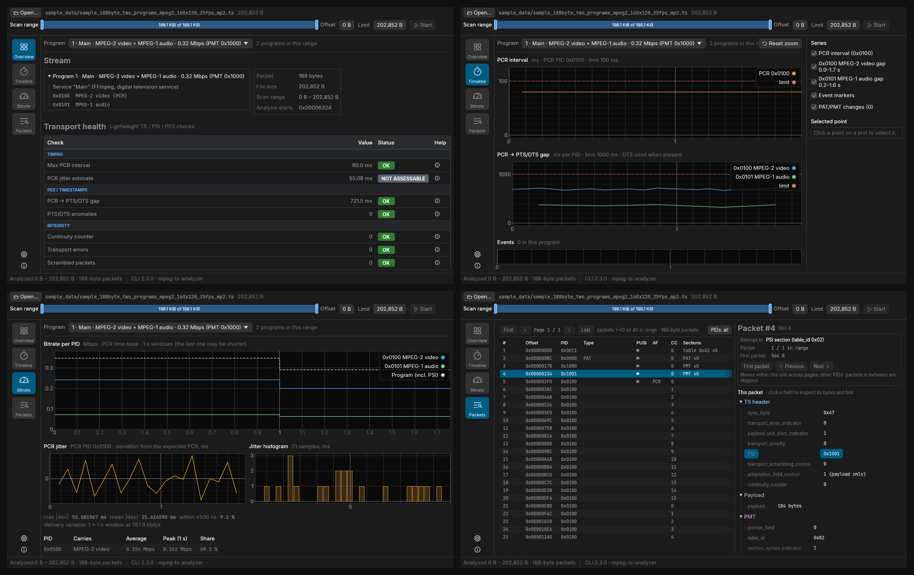
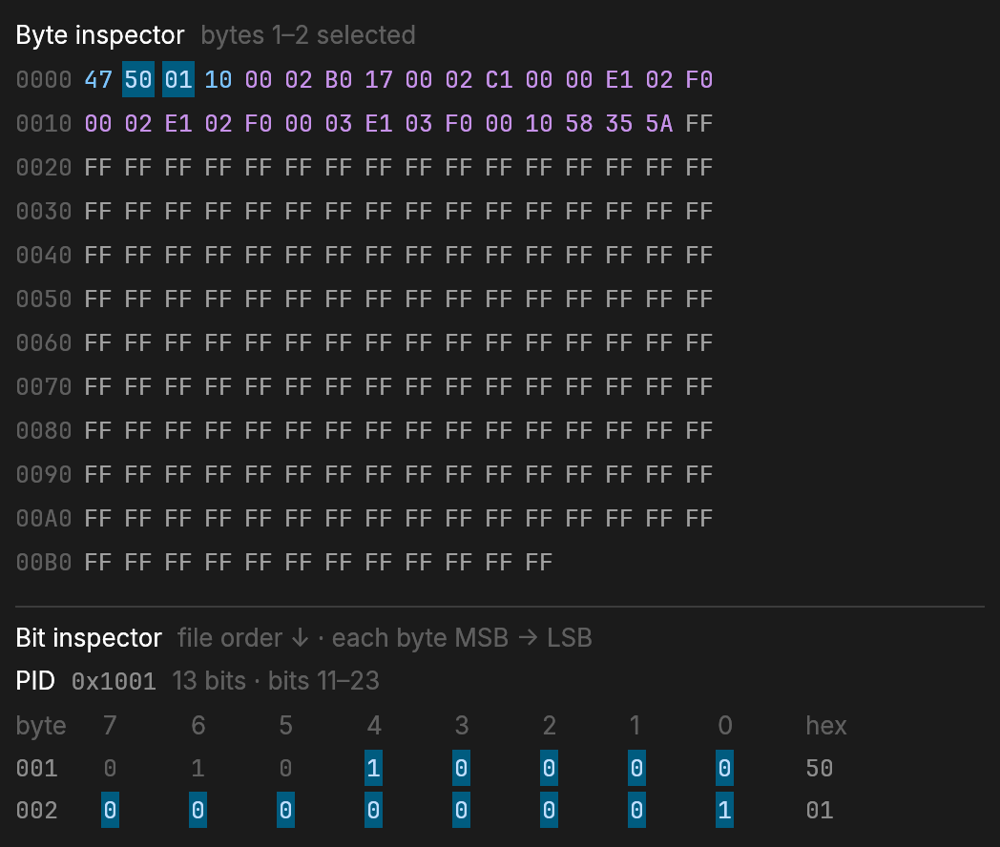

# Desktop GUI

[Documentation home](../index.md)

A desktop GUI is under active development in [`gui/`](https://github.com/small-teton/mpeg-ts-analyzer/tree/master/gui). It runs the CLI
as a subprocess and connects the Overview, Timeline, Bitrate, and Packets views
to the same analysis results.

Packages for macOS, Linux and Windows are described in
[Installation](../getting-started/installation.md#desktop-gui).

[](../images/gui-tabs.png)

- **Overview** brings the detected program layout, stream properties, the
  transport-health checks (timing, PES timestamps, continuity, transport
  errors and scrambling, TS synchronization, referenced and unreferenced
  PIDs), and
  per-stream bitrate into one screen, with a full-page explanation of every
  check.
- **Timeline** plots the PCR interval and the PCR → PTS/DTS gap of every
  elementary stream against their limits, with continuity and PAT/PMT events.
- **Bitrate** shows the bitrate of each PID over the range, the PCR jitter and
  its histogram.
- **Packets** pages through the packets of the range and decodes the selected
  one, with the PES or section it belongs to.

## Read the Overview verdicts

Overview shows a **Transport health** table for the selected program. Each
row is one check with the value and the verdict the CLI reported (`OK`, `NG`,
`WARNING`, `ANOMALIES`, `ERRORS`, `AFFECTED`, `DATA EXCLUDED`, `RECOVERED`,
`LOST`, `ABSENT`, `SILENT`, `UNREFERENCED`, `INSUFFICIENT DATA`,
`NOT ASSESSABLE` or `SKIPPED`), grouped
under categories that are always expanded:

| Category | Check | Applies to | Verdicts |
|---|---|---|---|
| Timing | Max PCR interval | selected program (its PCR PID) | `OK` up to 100 ms, `NG` above |
| Timing | PCR discontinuities | selected program (its PCR PID) | `OK` when every PCR clock jump is declared with `discontinuity_indicator`; `NG` for a backward step or a forward jump of more than 1000 ms without it |
| Timing | PCR jitter estimate | selected program (its PCR PID) | `OK` within ±500 ns, `WARNING` within ±25 µs, `NG` beyond, when delivery is constant; otherwise `NOT ASSESSABLE` |
| PES / Timestamps | PCR → PTS/DTS gap | selected program | `OK` up to 1000 ms, `NG` above |
| PES / Timestamps | PTS/DTS anomalies | selected program, per PID | `OK` or `ANOMALIES` |
| PES / Timestamps | PES headers | every elementary stream of the analyzed programs, per PID | `OK` when every checked header is valid, `ERRORS` when one is truncated or has a bad start code, flags, lengths or PTS/DTS marker bits, `INSUFFICIENT DATA` when none could be checked |
| PES / Timestamps | PTS repetition | every video and audio stream of the analyzed programs, per PID | `OK` up to 700 ms between PES packets carrying a PTS, `NG` above (ISO/IEC 13818-1 2.7.4, TR 101 290 PTS_error), `INSUFFICIENT DATA` when nothing could be measured, `SKIPPED` without a video or audio stream |
| Integrity | Continuity counter | whole multiplex | `OK` or `ERRORS` |
| Integrity | Transport errors | whole multiplex, every packet of the range | `OK` without `transport_error_indicator`; `AFFECTED` when no marked packet carried data the analysis reads; `DATA EXCLUDED` when one did and its data was left out |
| Integrity | Scrambled packets | whole multiplex, every packet of the range | `OK` without scrambled packets; `AFFECTED` or `DATA EXCLUDED` as for transport errors |
| Integrity | TS synchronization | whole multiplex | `OK`; `RECOVERED` when packets lost their sync byte and the analysis realigned; `LOST` when it could not realign and stopped there |
| Structure | Referenced PIDs | whole multiplex, every program of the PAT | `OK`; `ABSENT` when a PMT, PCR, video or audio PID had no packet while referenced for more than 5000 ms; `SILENT` when it went more than 5000 ms without one; `INSUFFICIENT DATA` when a PID without packets was referenced too briefly, may be idle (private data), or there is no PCR |
| Structure | Unreferenced PIDs | whole multiplex | `OK`; `UNREFERENCED` when a PID carried packets without a PAT/PMT reference for more than 500 ms; `INSUFFICIENT DATA` when a PID appeared too close to the end of the range; `SKIPPED` when not every program's PMT was followed |

The table always lists the checks in this order. The verdict is shown exactly
as the CLI reported it; a status this GUI does not know is still shown, with a
tooltip saying so. In a narrow window the check names wrap and the Value,
Status and Help columns keep their width, so every verdict stays visible
without scrolling sideways.

The **ⓘ** button in the Help column opens the check's page inside Overview;
Overview stays selected in the left rail. The button can be reached with Tab
and opened with Enter or Space. The page shows:

- the **current result** — only what the CLI reported for this check, such as
  the value, the limit, the program or PCR PID, the number of observations,
  the first or worst offset, and the reason a check was skipped or not
  assessed; for PCR jitter also the delivery assessment and its evidence; for
  TS synchronization the losses, realignments, skipped bytes, the first loss
  and the largest skipped span with their offsets, and a partial packet at
  the end of the input; for Referenced and Unreferenced PIDs the PIDs that
  are not `OK`, grouped by status with their program, role and longest
  silence or unreferenced time, and the limit;
- the check's **findings**, each with **Open packet** when it has an offset
  (for transport errors and scrambled packets, the first affected packet of
  each PID; for PES headers, the first malformed header of each PID; for PTS
  repetition, the end of the first interval over 700 ms on each PID)
  and **Show on timeline** when Timeline marks it (a continuity error on a PID
  of the program);
- the **verdicts**: every status the check can report and the condition behind
  it, with the current one highlighted;
- what the check measures, what it applies to, what the value means, when it
  is skipped and its limitations;
- a button that opens Timeline, Bitrate or Packets with the details.

**Back to Overview** (or the Overview tile) returns to the table at the same
scroll position, with the same program selected. Opening or leaving a page
never runs the analysis again.

PCR jitter is an **estimate**. A file has no packet-arrival timestamps, so the
byte position stands in for time, which is exact only when the stream is
delivered at a constant rate. The CLI therefore first assesses the delivery
from the stream itself — its multiplex rate over 1-second windows must stay
within ±1 % of the average, and no estimated jitter may reach 1 ms — and grades
the estimate only when delivery is `constant`. For a `variable` or `unknown`
delivery, such as a variable-bitrate stream without stuffing or a range shorter
than about two seconds, the row shows `NOT ASSESSABLE` with the estimate as its
value, and the page gives the CLI's reason. The page always gives the delivery
assessment and its evidence, for example `2 × 1 s windows, max deviation
0.00 % of 75.2 kbit/s`. Even a graded estimate is not a direct hardware or
TR 101 290 measurement.

**PCR discontinuities** classifies each PCR against the previous one, in the
same way the CLI uses for every PCR-based result: a 33-bit wraparound is a
normal interval, a declared discontinuity or a `PCR_PID` change starts a new
timing segment legally, and a backward step or a forward jump of more than
1000 ms without `discontinuity_indicator` is a finding. Its page lists each
kind with its count, first offset and how far the PCR jumped. Max PCR interval
measures only the intervals within a segment, so a clean interval and an
undeclared jump show as two separate rows rather than one `OK`. The
intentionally invalid PCR-discontinuities sample
(`sample_data/sample_188byte_pcr_discontinuities.ts`) shows every kind.

TS synchronization covers every packet from the start of the analysis. When a
packet does not start with the sync byte, the CLI skips ahead to the next
offset where five consecutive packets do and continues there, so later checks
still report results. The skipped bytes are not analyzed, and their packets
usually also show as continuity errors. `LOST` means no new alignment was
found within 1 MiB or before the end of the range, so the analysis stopped
early. Packets pages through the range at the alignment of its start, so
packets after a realignment can appear there as invalid. The sample
`sample_data/sample_188byte_sync_loss.ts` shows a `RECOVERED` result.

Referenced and Unreferenced PIDs compare the PIDs the PAT and PMTs reference
with the PIDs that carry packets, for every program of the multiplex. A video,
audio, PCR or PMT PID that carries nothing, or stops for more than 5 s, is
`ABSENT` or `SILENT`; streams that may be idle, such as subtitles or private
data, only have their presence reported. A PID that carries packets without
a reference for more than 0.5 s is `UNREFERENCED`; packets read before the
first PAT and PMT, and a stream added or removed by a PMT change within that
time, do not count. Times are estimated from byte positions between PCRs. The
sample `sample_data/sample_188byte_pid_references.ts` shows each status.

**Findings** lists everything that needs attention, and its count includes
every check that is not `OK`: each failed check, each kind of undeclared PCR
discontinuity (at its first PCR), each PTS/DTS anomaly kind per PID, each continuity error (with its offset), PCR jitter, each PID with
transport errors or scrambled packets (with its first offset), a loss of TS
synchronization (at the offset of the first loss, with the number of losses
and skipped bytes, and the CLI's reason when the analysis stopped), each PID
with malformed PES headers or a PTS interval over the limit (in its program,
with the offset), each referenced PID that is `ABSENT` or `SILENT` (at the
packet before its longest silence) and each `UNREFERENCED` PID (at its first
unreferenced packet), with their own status, and the analyzer's warnings. Each row shows the verdict, the check, the reason and whether it
concerns the selected program or the whole multiplex; selecting the check
opens its page. A check counts once through its own events, not again for its
total. A check the CLI skipped, a PCR jitter estimate the CLI found
`not_assessable`, a PES check the CLI reported as `INSUFFICIENT DATA`, and
referenced or unreferenced PIDs the CLI could not judge (`INSUFFICIENT DATA`:
a PID referenced too briefly, one that may be idle, one that appeared too
close to the end of the range, or no PCR) are listed under
**Unavailable analysis** instead, with the CLI's reason; they are not
findings. The GUI shows the CLI's verdicts as they
are and never changes them.

To see every verdict at once, open the intentionally invalid
[diagnostic sample](../development/sample-data.md#diagnostic-sample-with-every-overview-finding):

```sh
make gui-run GUI_ARGS='sample_data/sample_188byte_all_findings.ts'
```

Its PCR clock is continuous, so PCR discontinuities stays `OK` there; open
`sample_data/sample_188byte_pcr_discontinuities.ts` for that check.

## Open a file from the command line

The GUI normally opens with a file picker. For repeatable inspection, pass a
file and optional byte range to open it and start analysis immediately:

```sh
mpeg-ts-analyzer-gui capture.ts --offset 0 --limit 67108864
```

`--limit 0` analyzes from the offset through the end of the file. Development
builds accept the same arguments:

```sh
make gui-run GUI_ARGS='capture.ts --offset 0 --limit 67108864'
```

## Inspect packets down to individual bits

Select any decoded TS, adaptation-field, PSI, or PES field to highlight both
its source bytes and its exact bit range. Multi-byte, non-byte-aligned fields
are shown across byte boundaries; the 13-bit PID in the packet view spans the
low five bits of one byte and all eight bits of the next byte.

[](../images/gui-inspectors.png)

The Bit inspector follows packet/file order from top to bottom and displays
each byte from MSB (`bit 7`) to LSB (`bit 0`), making it straightforward to
compare raw packet data with ISO/IEC 13818-1 field layouts. The close-up above
is the same Byte and Bit inspector shown in Packets: the PID `0x1001` of a PMT
packet is selected, so its bytes are highlighted and its 13 bits are marked
across the two bytes they span.

Both images are rendered from fixtures by the GUI's tests rather than captured
by hand; see [README screenshots](../development/index.md#readme-screenshots).
