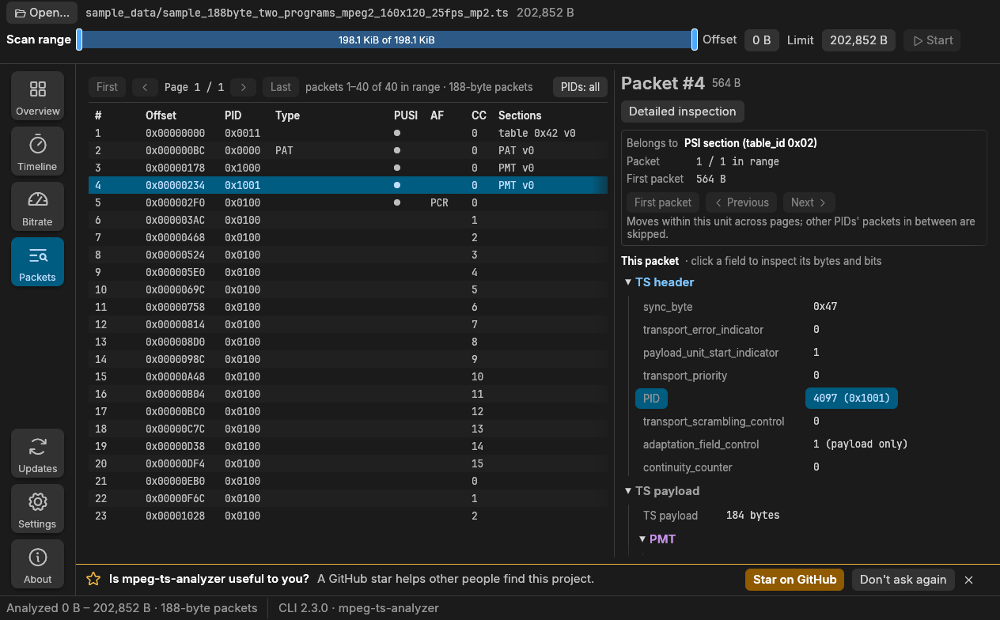
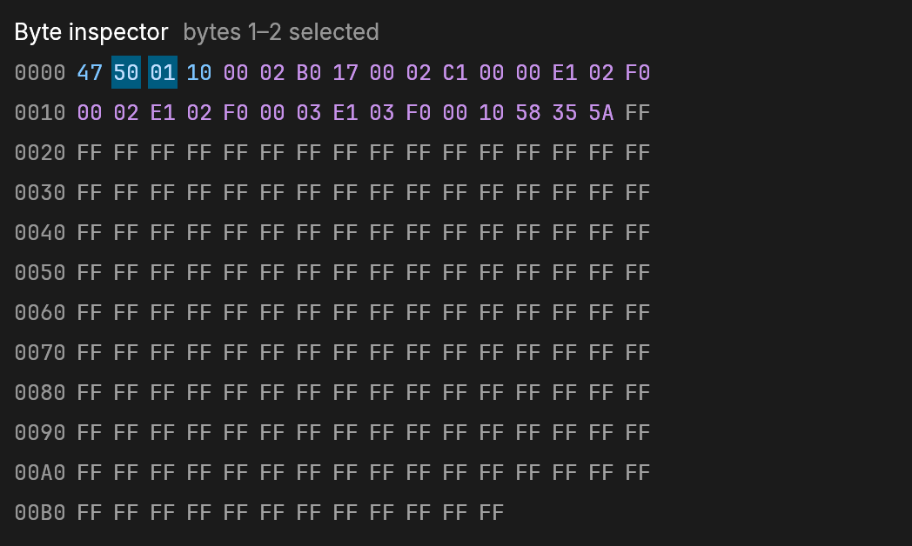
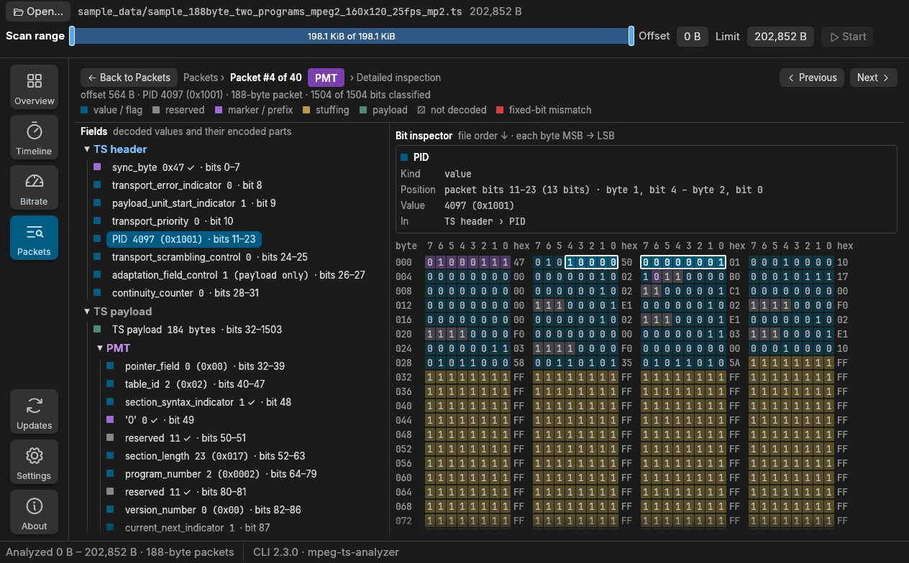
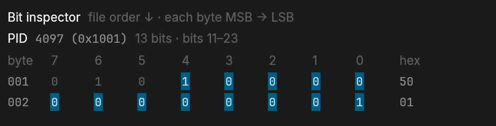

# Desktop GUI

[Documentation home](../index.md)

A desktop GUI is under active development in [`gui/`](https://github.com/small-teton/mpeg-ts-analyzer/tree/master/gui). It runs the CLI
as a subprocess and connects the Overview, Timeline, Bitrate, and Packets views
to the same analysis results.

Packages for macOS, Linux and Windows are described in
[Installation](../getting-started/installation.md#desktop-gui).

[](../images/gui-tabs.png)

- **Overview** brings the detected program layout, stream properties, the
  transport-health checks (timing, PES timestamps, continuity, transport
  errors and scrambling, TS synchronization, PAT/PMT structure, referenced
  and unreferenced PIDs, and the report-only mux lead), and
  per-stream bitrate into one screen, with a full-page explanation of every
  check.
- **Timeline** plots the PCR interval and the PCR → PTS/DTS gap of every
  elementary stream against their limits, with continuity and PAT/PMT events.
- **Bitrate** shows the bitrate of each PID over the range, the PCR jitter and
  its histogram.
- **Packets** pages through the packets of the range and decodes the selected
  one, with the PES or section it belongs to.

When the selected range cannot be analyzed, for example because it is too
short to find the packet alignment or contains no complete PAT, the GUI shows
an **Analysis failed** dialog with what to do (select a longer range, or one
that includes a PAT) and the CLI's explanation: the range, how many packets
were aligned and what was found on PID 0. The analysis needs the PAT for the
program layout, so such a range gets no Overview, health checks or findings;
the previous result stays shown. See
[When the analysis cannot start](../cli/usage.md#when-the-analysis-cannot-start).

## The star reminder

After three successful analyses, a row above the status bar asks whether
mpeg-ts-analyzer is useful to you and offers **Star on GitHub**. It appears
on every screen without covering it, and gently pulses until you choose:
**Star on GitHub** opens the project page in your browser, **Don't ask again**
hides it for good, and the close button hides it until five more analyses.
The GUI does not sign in to GitHub or check whether you already starred the
project. See [Star reminder](design.md#star-reminder).

[](../images/gui-star-reminder.png)

## Read the Overview verdicts

Overview shows a **Transport health** table for the selected program. Each
row is one check with the value and the verdict the CLI reported (`OK`, `NG`,
`WARNING`, `ANOMALIES`, `ERRORS`, `AFFECTED`, `DATA EXCLUDED`, `RECOVERED`,
`LOST`, `ABSENT`, `SILENT`, `UNREFERENCED`, `INSUFFICIENT DATA`,
`NOT ASSESSABLE` or `SKIPPED`, or `INFO` for a report without a verdict), grouped
under categories that are always expanded:

| Category | Check | Applies to | Verdicts |
|---|---|---|---|
| Timing | Max PCR interval | selected program (its PCR PID) | `OK` up to 100 ms, `NG` above |
| Timing | PCR discontinuities | selected program (its PCR PID) | `OK` when every PCR clock jump is declared with `discontinuity_indicator`; `NG` for a backward step or a forward jump of more than 1000 ms without it |
| Timing | PCR jitter estimate | selected program (its PCR PID) | `OK` within ±500 ns, `WARNING` within ±25 µs, `NG` beyond, when delivery is constant; otherwise `NOT ASSESSABLE` |
| PES / Timestamps | PCR → PTS/DTS gap | selected program | `OK` up to 1000 ms, `NG` above |
| PES / Timestamps | PTS/DTS anomalies | selected program, per PID | `OK` or `ANOMALIES` |
| PES / Timestamps | PES headers | every elementary stream of the analyzed programs, per PID | `OK` when every checked header is valid, `ERRORS` when one is truncated or has a bad start code, flags, lengths or PTS/DTS marker bits, `INSUFFICIENT DATA` when none could be checked |
| PES / Timestamps | PTS repetition | every video and audio stream of the analyzed programs, per PID | `OK` up to 700 ms between PES packets carrying a PTS, `NG` above (ISO/IEC 13818-1 2.7.4, TR 101 290 PTS_error), `INSUFFICIENT DATA` when nothing could be measured, `SKIPPED` without a video or audio stream |
| Integrity | Continuity counter | whole multiplex | `OK` or `ERRORS` |
| Integrity | Transport errors | whole multiplex, every packet of the range | `OK` without `transport_error_indicator`; `AFFECTED` when no marked packet carried data the analysis reads; `DATA EXCLUDED` when one did and its data was left out |
| Integrity | Scrambled packets | whole multiplex, every packet of the range | `OK` without scrambled packets; `AFFECTED` or `DATA EXCLUDED` as for transport errors |
| Integrity | TS synchronization | whole multiplex | `OK`; `RECOVERED` when packets lost their sync byte and the analysis realigned; `LOST` when it could not realign and stopped there |
| Structure | PAT health | whole multiplex (PID 0x0000), every packet of the range | `OK` when the PAT repeats at least every 500 ms (ETSI TR 101 290 1.3.a) and every section is usable; `NG` for a late, missing or unusable PAT; `INSUFFICIENT DATA` when the range does not show it repeating |
| Structure | PMT health | selected program's PMT | `OK`, `NG` or `INSUFFICIENT DATA` as for the PAT (TR 101 290 1.5.a) |
| Structure | Referenced PIDs | whole multiplex, every program of the PAT | `OK`; `ABSENT` when a PMT, PCR, video or audio PID had no packet while referenced for more than 5000 ms; `SILENT` when it went more than 5000 ms without one; `INSUFFICIENT DATA` when a PID without packets was referenced too briefly, may be idle (private data), or there is no PCR |
| Structure | Unreferenced PIDs | whole multiplex | `OK`; `UNREFERENCED` when a PID carried packets without a PAT/PMT reference for more than 500 ms; `INSUFFICIENT DATA` when a PID appeared too close to the end of the range; `SKIPPED` when not every program's PMT was followed |
| Multiplexing | Packet gaps | PIDs of the selected program (PMT, PCR, elementary streams) | `INFO`: a report without a verdict, never a finding; `INSUFFICIENT DATA` when no PID of the program has two consecutive packets |
| Multiplexing | Mux lead | every elementary stream of the selected program, per PID | Report only, no verdict: `INFO` when a lead (DTS/PTS minus PCR-interpolated arrival) was measured, with the largest audio/video lead difference as the value; `INSUFFICIENT DATA` when no stream has a measured lead. Never a finding |

The table always lists the checks in this order. The verdict is shown exactly
as the CLI reported it; a status this GUI does not know is still shown, with a
tooltip saying so. In a narrow window the check names wrap and the Value,
Status and Help columns keep their width, so every verdict stays visible
without scrolling sideways.

The badge color shows how serious the verdict is:

- Green: `OK`.
- Red: `NG`, `ERRORS`, `LOST`, `ABSENT`, and `DATA EXCLUDED` of Transport
  errors (damaged packets removed data the analysis needed).
- Yellow: `WARNING`, `ANOMALIES`, `RECOVERED`, `SILENT`, `UNREFERENCED`,
  `AFFECTED`, and `DATA EXCLUDED` of Scrambled packets (scrambling is not an
  error in itself).
- Gray: `INFO`, `SKIPPED`, `NOT ASSESSABLE`, `INSUFFICIENT DATA`, and any
  status this GUI does not know, which is never colored as a problem.

The **ⓘ** button in the Help column opens the check's page inside Overview;
Overview stays selected in the left rail. The button can be reached with Tab
and opened with Enter or Space. The page shows:

- the **current result** — only what the CLI reported for this check, such as
  the value, the limit, the program or PCR PID, the number of observations,
  the first or worst offset, and the reason a check was skipped or not
  assessed; for PCR jitter also the delivery assessment and its evidence; for
  TS synchronization the losses, realignments, skipped bytes, the first loss
  and the largest skipped span with their offsets, and a partial packet at
  the end of the input; for Referenced and Unreferenced PIDs the PIDs that
  are not `OK`, grouped by status with their program, role and longest
  silence or unreferenced time, and the limit; for Packet gaps the largest
  gap of the program's elementary streams and a Per PID table with each
  PID's largest gap and **Open packet** buttons for the packets before and
  after it; for Mux lead the A/V lead
  difference with both PES packets, the range of leads, negative and
  unbracketed PES, followed by a **Per PID** table (smallest and largest lead
  with their PES packets, spread, unbracketed PES) and an **A/V lead
  difference per audio stream** table whose offsets open the packets in
  **Packets**;
- the check's **findings**, each with **Open packet** when it has an offset
  (for transport errors and scrambled packets, the first affected packet of
  each PID; for PES headers, the first malformed header of each PID; for PTS
  repetition, the end of the first interval over 700 ms on each PID)
  and **Show on timeline** when Timeline marks it (a continuity error on a PID
  of the program);
- the **verdicts**: every status the check can report and the condition behind
  it, with the current one highlighted;
- what the check measures, what it applies to, what the value means, when it
  is skipped and its limitations;
- **CI exit status**: the CLI's `--fail-on` category of the check and which of
  its statuses make the command exit 2 when that category is selected
  (skipped and insufficient data never do), or, for the PCR jitter estimate,
  packet gaps and mux lead, that they never change the exit status. The GUI
  itself does not use the exit status (see
  [CI failure policies](../cli/usage.md#ci-failure-policies---fail-on));
- a button that opens Timeline, Bitrate or Packets with the details.

**Back to Overview** (or the Overview tile) returns to the table at the same
scroll position, with the same program selected. Opening or leaving a page
never runs the analysis again.

PCR jitter is an **estimate**. A file has no packet-arrival timestamps, so the
byte position stands in for time, which is exact only when the stream is
delivered at a constant rate. The CLI therefore first assesses the delivery
from the stream itself — its multiplex rate over 1-second windows must stay
within ±1 % of the average, and no estimated jitter may reach 1 ms — and grades
the estimate only when delivery is `constant`. For a `variable` or `unknown`
delivery, such as a variable-bitrate stream without stuffing or a range shorter
than about two seconds, the row shows `NOT ASSESSABLE` with the estimate as its
value, and the page gives the CLI's reason. The page always gives the delivery
assessment and its evidence, for example `2 × 1 s windows, max deviation
0.00 % of 75.2 kbit/s`. Even a graded estimate is not a direct hardware or
TR 101 290 measurement.

**PCR discontinuities** classifies each PCR against the previous one, in the
same way the CLI uses for every PCR-based result: a 33-bit wraparound is a
normal interval, a declared discontinuity or a `PCR_PID` change starts a new
timing segment legally, and a backward step or a forward jump of more than
1000 ms without `discontinuity_indicator` is a finding. Its page lists each
kind with its count, first offset and how far the PCR jumped. Max PCR interval
measures only the intervals within a segment, so a clean interval and an
undeclared jump show as two separate rows rather than one `OK`. The
intentionally invalid PCR-discontinuities sample
(`sample_data/diagnostics/sample_188byte_pcr_discontinuities.ts`) shows every kind.

TS synchronization covers every packet from the start of the analysis. When a
packet does not start with the sync byte, the CLI skips ahead to the next
offset where five consecutive packets do and continues there, so later checks
still report results. The skipped bytes are not analyzed, and their packets
usually also show as continuity errors. `LOST` means no new alignment was
found within 1 MiB or before the end of the range, so the analysis stopped
early. Packets pages through the range at the alignment of its start, so
packets after a realignment can appear there as invalid. The sample
`sample_data/diagnostics/sample_188byte_sync_loss.ts` shows a `RECOVERED` result.

Referenced and Unreferenced PIDs compare the PIDs the PAT and PMTs reference
with the PIDs that carry packets, for every program of the multiplex. A video,
audio, PCR or PMT PID that carries nothing, or stops for more than 5 s, is
`ABSENT` or `SILENT`; streams that may be idle, such as subtitles or private
data, only have their presence reported. A PID that carries packets without
a reference for more than 0.5 s is `UNREFERENCED`; packets read before the
first PAT and PMT, and a stream added or removed by a PMT change within that
time, do not count. Times are estimated from byte positions between PCRs. The
sample `sample_data/diagnostics/sample_188byte_pid_references.ts` shows each status.

**Packet gaps** reports, for each PID of the selected program, the longest run
of other packets between two of its packets, in packets (exact) and in
milliseconds estimated from byte positions between PCRs (`at least` when the
gap lies outside the PCRs of the analysis or crosses a PCR discontinuity). A
remux that sends audio in large blocks shows a long gap even when its average
bitrate is right. It is a report only: there is no limit, its `INFO` status is
neutral, it never adds a finding and never changes the CLI's exit status. A
stream removed by a PMT change and added back later has no gap across its
absence. The bursty sample `sample_data/diagnostics/sample_188byte_packet_gaps.ts` shows
it.

**Mux lead** reports, for each elementary stream of the selected program, how
far ahead of its decode time it is multiplexed (DTS, or PTS without DTS, minus
the arrival estimated from byte position between PCRs): the smallest and
largest lead with their PES packets and the spread, and for a program with
video and audio the largest difference between an audio lead and the video
lead. It is a report only: its `INFO` status is neutral, a negative lead is an
observation, it never adds a finding and never changes the CLI's exit status;
the PCR → PTS/DTS gap judges the largest lead. The audio-preload sample
`sample_data/diagnostics/sample_188byte_mux_lead.ts` shows it.

**Findings** lists everything that needs attention, and its count includes
every check that is not `OK`: each failed check, each kind of undeclared PCR
discontinuity (at its first PCR), each PTS/DTS anomaly kind per PID, each continuity error (with its offset), PCR jitter, each PID with
transport errors or scrambled packets (with its first offset), a loss of TS
synchronization (at the offset of the first loss, with the number of losses
and skipped bytes, and the CLI's reason when the analysis stopped), a failed
PAT or PMT (with its first problem or late interval), each PID with malformed
PES headers or a PTS interval over the limit (in its program, with the
offset), each referenced PID that is `ABSENT` or `SILENT` (at the packet
before its longest silence) and each `UNREFERENCED` PID (at its first
unreferenced packet), with their own status, and the analyzer's warnings. Each row shows the verdict, the check, the reason and whether it
concerns the selected program or the whole multiplex; selecting the check
opens its page. A check counts once through its own events, not again for its
total. A check the CLI skipped, a PCR jitter estimate the CLI found
`not_assessable`, a PAT or PMT with `INSUFFICIENT DATA`, a PES check the CLI
reported as `INSUFFICIENT DATA`, and referenced or unreferenced PIDs the CLI
could not judge (`INSUFFICIENT DATA`: a PID referenced too briefly, one that
may be idle, one that appeared too close to the end of the range, or no PCR)
are listed under **Unavailable analysis** instead, with the CLI's reason;
they are not findings. The GUI shows the CLI's verdicts as they
are and never changes them.

To see every verdict at once, open the intentionally invalid
[diagnostic sample](../development/sample-data.md#diagnostic-sample-with-every-overview-finding):

```sh
make gui-run GUI_ARGS='sample_data/diagnostics/sample_188byte_all_findings.ts'
```

Its PCR clock is continuous, so PCR discontinuities stays `OK` there; open
`sample_data/diagnostics/sample_188byte_pcr_discontinuities.ts` for that check.

## Open a file from the command line

The GUI normally opens with a file picker. For repeatable inspection, pass a
file and optional byte range to open it and start analysis immediately:

```sh
mpeg-ts-analyzer-gui capture.ts --offset 0 --limit 67108864
```

`--limit 0` analyzes from the offset through the end of the file. Development
builds accept the same arguments:

```sh
make gui-run GUI_ARGS='capture.ts --offset 0 --limit 67108864'
```

## Inspect packets down to individual bits

Select any decoded TS, adaptation-field, PSI, or PES field to highlight both
its source bytes and its exact bit range. Multi-byte, non-byte-aligned fields
are shown across byte boundaries; the 13-bit PID in the packet view spans the
low five bits of one byte and all eight bits of the next byte.

<table markdown="1">
<tr markdown="1">
<td width="36%" markdown="block">

[](../images/gui-byte-inspector.png)

</td>
<td width="64%" rowspan="2" markdown="block">

[](../images/gui-wire-layout.png)

</td>
</tr>
<tr markdown="1">
<td markdown="block">

[](../images/gui-bit-inspector.png)

</td>
</tr>
</table>

*Left: the Byte and Bit inspectors of the Packets pane. Right: Detailed
inspection of the same PMT packet with its PID selected.*

Detailed inspection lays a packet out bit by bit, the way ISO/IEC 13818-1
draws its syntax:

- **Every bit has a role.** Each bit of the packet belongs to one part, shown
  in a colored grid: decoded values and flags, and also reserved bits, marker
  bits, prefixes, stuffing and bytes the analyzer does not decode.
- **Fixed bits are checked.** Bits whose value the specification fixes are
  marked ✓ or flagged in red with the expected value, and the rule is cited.
- **Select a field, see its bits.** Its exact bits are highlighted, with its
  value in decimal and hexadecimal, its position and the structure it belongs
  to.
- **188, 192 and 204-byte packets**: the M2TS header and the 204-byte trailer
  are part of the layout.

The Bit inspector follows packet/file order from top to bottom and displays
each byte from MSB (`bit 7`) to LSB (`bit 0`), making it straightforward to
compare raw packet data with ISO/IEC 13818-1 field layouts. The close-ups
above are the same Byte and Bit inspectors shown in Packets: the PID of a PMT
packet is selected, so its bytes are highlighted and its 13 bits are marked
across the two bytes they span.

Numbers are shown decimal first with the hexadecimal in parentheses, padded to
the field's width: PID `4097 (0x1001)`, table_id `2 (0x02)`, section_length
`23 (0x017)`, a PTS `144000 (0x000023280, 1.600000 s)`. Fields of four bits
or fewer (flags, continuity_counter) stay decimal, and bit patterns (reserved
`111`, the parts of a PTS) stay binary. CRC_32, the sync byte and the PES
start code prefix stay hexadecimal, and a PCR or OPCR stays a 27 MHz count
with its time (its base and extension parts get both notations). The CLI's
JSON is unchanged; this is only how the GUI shows it.

For 204-byte packets, the Byte inspector shows all 204 bytes: the 188-byte TS
packet colored by layer, then the 16-byte trailer in its own color. The
trailer is listed as "Trailer (after the TS packet; not decoded)"; selecting
it highlights bytes 188–203. It is not decoded, validated or labeled as
Reed-Solomon parity.

### Detailed inspection: the complete wire layout

The compact Bit inspector shows the bits a decoded value is read from. To read
a packet beside ISO/IEC 13818-1 bit by bit, press **Detailed inspection**:
the button is under the packet heading and again at the very end of the
pane, after the Bit inspector. Packets then shows that packet on a full-width
page: every structure, decoded field and encoded part on the left, and every
bit of the packet on the right, colored by what it is on the wire.

[](../images/gui-wire-layout.png)

- A badge right after "Packet #n of N" in the header says what the packet is: `PAT`,
  `PMT`, another PSI/SI table (`SDT`, `EIT`, …, or `… · continued` for a
  section that started in an earlier packet), `PES · H.264 video` (the stream
  type the PMT announces, else the stream_id's class), `PES payload · …` for a
  later packet of a PES packet, `PCR only` or `Adaptation field only`, or
  `Null`.
- Reserved bits, marker bits and fixed prefixes, stuffing and bytes the
  analyzer does not decode have lines and colors of their own, so "reserved by
  the specification" (gray) is never confused with "not decoded" (striped).
- Where the specification fixes the bits (sync byte, start code, `'10'`, PTS
  prefix, marker bits, PAT/PMT fixed bits, reserved bits, stuffing bytes), the
  line shows ✓ or "✗ expected …", a mismatch is red in the grid, and the
  selected part names the rule.
- The TS packet's payload is called "TS payload", so it is not confused with
  the PES payload. The PES header or PSI section (PAT, PMT, …) is listed
  inside it, since it decodes the payload's bytes, followed by what is left
  of the TS payload: "PES payload" (the elementary-stream data) after a PES
  header, "Stuffing" (all 0xFF) or "Rest of the TS payload" after a section,
  and nothing when the section or header fills the payload. A later packet
  of a PES packet is all "PES payload (continued)"; another payload that is
  not decoded (a section's continuation or a scrambled payload) is just its
  TS payload line.
- Selecting a line marks every bit it covers: "TS payload" marks the whole
  payload, the section or PES header inside it included, while a field of
  the section marks just that field.
- A PTS, DTS, PCR or OPCR is one line spanning its whole encoding, with its
  prefix, value runs, reserved and marker bits beneath it; a PAT program or
  PMT stream likewise lists its fields and reserved bits.
- Hover a bit for its part, position and value; click it to select the part.
- With a line selected, ↑ / ↓ move the selection to the previous or next line
  of the field list as shown (the lines inside a collapsed field or entry are
  skipped), updating the grid and the facts and scrolling the list to it.
- Previous / Next, or the ← / → keys, step through the packets of the
  analyzed range; **Back to Packets** returns to the list with its page,
  filter, selected row and scroll position.

The layout comes from the `bit_layout` of the packet detail
([Wire layout](../reference/json-output.md#wire-layout)). With a CLI that does
not report it, the page classifies only the bits of decoded fields.

These images are rendered from fixtures by the GUI's tests rather than captured
by hand; see [README screenshots](../development/index.md#readme-screenshots).
